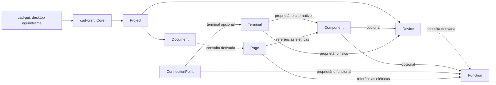
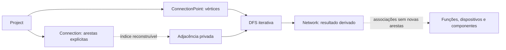
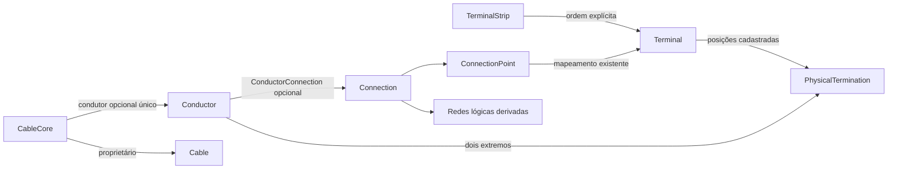
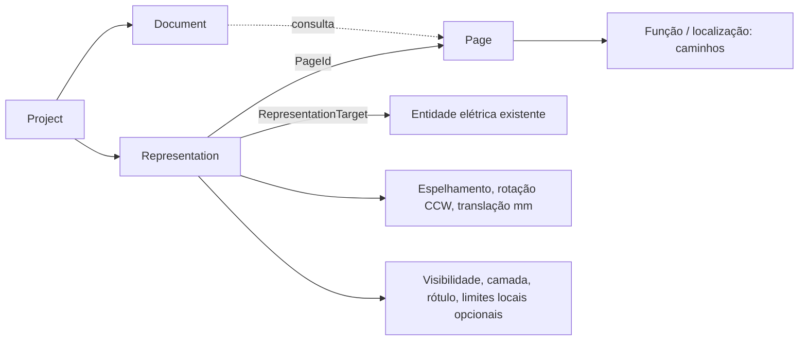
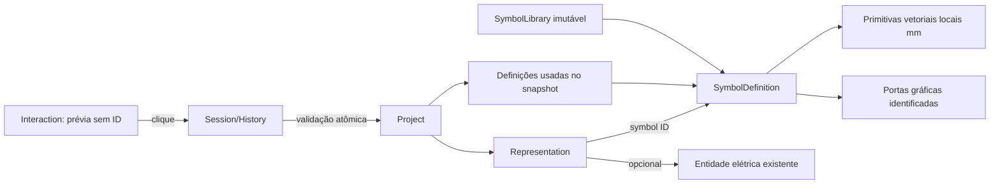

# Arquitetura

## Implementado nas Etapas 1–8

`cad-gui -> cad-craft -> std + serde + uuid`.
Core independente de GUI, janelas, renderização e coordenadas de tela.
No Core, `serde_json` é dependência exclusiva de testes. Na GUI, também atende
preferências e snapshots técnicos. Lockfile fixa versões resolvidas.
`cad-gui` é agora a aplicação desktop egui/eframe 0.33.3, backend Glow.
Release Windows usa subsistema gráfico; Debug mantém console diagnóstico.

`domain` exporta IDs, designações, metadados, propriedades, geometria e entidades.
`error` exporta `DomainError` e `Result`. Submódulos privados organizam responsabilidades;
não há módulos vazios. `Project` controla registros tipados e operações verificadas.
Detalhes e consequências no [ADR-0003](../../adr/0003-core-eletrico-e-integridade.md).

Registros pertencem ao Project; setas relacionais representam IDs, sem duplicação.
Consultas não expõem mutabilidade. Inserções verificam pertencimento, unicidade por
tipo de ID, existência e compatibilidade. `set_properties` verifica referências
antes da substituição. `add_page_element` rejeita alvos ausentes e duplicados.

Serde preserva IDs. O snapshot interno do Project usa listas, detecta duplicados
antes de aceitar o agregado e resolve referências após reunir todas as entidades.
Campos desconhecidos nos DTOs de estruturas são rejeitados. Entidade isolada não
garante integridade relacional até ser registrada em Project.

## Contratos atuais e futuros

- **Implementado:** milímetros, origem inferior esquerda, X direita/Y cima;
  `Point2D`, `Size2D`, `Rect2D` em f64 finito, operações verificadas.
- **Implementado:** IDs tipados UUID v7, incluindo RepresentationId;
  componente, dispositivo, função, terminal físico e ponto funcional separados;
  representações documentais referenciam entidades elétricas, sem renderização.
- **Implementado:** propriedades conhecidas com unidades fixas e customizadas
  tipadas; designações com caminhos funcionais/localização, sem conformidade IEC.
- **Implementado na GUI:** conversão para pontos lógicos egui, viewport e inversão de Y.
- **Implementado:** conexões lógicas explícitas e redes derivadas da conectividade.
- **Implementado:** condutores físicos, cabos/veias e réguas, com associação lógica explícita.
- **Implementado na Etapa 6:** lote atômico de transforms no Core e Undo/Redo
  gráfico de sessão na GUI. Histórico geral, persistência física versionada e
  migrações permanecem futuros.
- **Implementado:** navegação documental entre ocorrências do mesmo alvo.
- **Implementado na Etapa 7:** biblioteca de dez símbolos vetoriais, definições
  imutáveis, portas gráficas, inserção e histórico de inserção/aparência.
- **Futuro:** referências cruzadas mais amplas, bornes/cabos/
  conectores especializados, relatórios, ERC e exportação DXF/DWG/PDF/XLSX.

Não antecipar módulos desses contratos. Etapas 1–8 implementadas; resultados finais no relatório da Etapa 8. Etapa 17 permanece exclusivamente planejada.

## Conectividade da Etapa 2

Detalhes no [ADR-0004](../../adr/0004-conectividade-logica-e-redes-derivadas.md).
Connection mantém UUID v7, ProjectId e extremos canônicos não direcionados.
Project controla conexões em BTreeMap e um índice privado simétrico, reconstruível
e não serializado, em graph.rs. Não há dependência de grafo externa.

Inserções validam tudo antes da mutação. Remoção de conexão exige ausência de condutores
associados (Etapa 3) e representações (Etapa 4); depois atinge só a conexão e seu índice;
demais entidades permanecem. Não existe exclusão em cascata. Connection não possui
propriedades nem é alvo de EntityRef nesta etapa, evitando referências pendentes
em propriedades após sua remoção. Erros específicos carregam ConnectionId ou extremos.

DFS iterativa deriva redes após qualquer inserção/remoção, sem Union-Find ou cache.
Isolados formam redes unitárias; ciclos válidos são permitidos e identificados.
Resultados são fotografias imutáveis: membros por ID, redes pelo menor ponto.
As consultas de vizinhança e incidência usam o índice; consultas transitivas percorrem
o grafo. Componentes são associados por função explícita ou por terminal mapeado.
Terminais do mesmo dispositivo, função ou terminal físico nunca são unidos implicitamente.

Snapshot acrescenta connections, com default vazio ao ler a Etapa 1, e reconstrói o
índice depois de coletar os registros. validate confirma referências e equivalência
do índice. Network não é serializada nem possui ID independente. A serialização
permanece estrutural, sem formato físico final, schema/migrações ou salvamento.
Conexão lógica não equivale a condutor físico nem representação gráfica.

## Modelo físico da Etapa 3

Detalhes no [ADR-0005](../../adr/0005-condutores-cabos-e-terminacoes.md).
Terminal continua sendo o terminal físico de dispositivo/componente; posições
DesignationPart são cadastradas explicitamente. PhysicalTermination é a referência
composta TerminalId + posição. Snapshots antigos carregam posições vazias.

Cable tem capacidade nominal; veias parciais/livres são válidas. Condutor independente
não precisa de cabo nem conexão lógica. Seção mm², comprimento mm, cor/identificação,
material e função são valores controlados. Cor não implica função. Propriedades e
EntityRef suportam entidades físicas não removíveis; seção nominal não se duplica
em propriedades. Posições e réguas não determinam continuidade interna.

O agregado mantém registros físicos BTreeMap e PhysicalIndex privado. Índices
de duplicação, associação e incidência evitam construção quadrática; não são fonte
persistente. validate confere referências/compatibilidade e reconstrói os índices.
Core guarda o vínculo ao condutor; referências inversas/cabo são derivadas. Strip
guarda terminais ordenados. Conductor guarda ConnectionId e source_point opcional;
o outro ponto vem da Connection. Assign/unassign nunca alteram o grafo lógico.

Consultas físicas por conexão e dispositivo devolvem PhysicalElements: fotografias
de IDs únicos ordenados, sem copiar entidades inteiras. A consulta por dispositivo
considera seus terminais diretos e de componentes explicitamente associados.
ConnectionInUse impede remover conexão ainda documentada; desvincular é explícito.
Sem remoções em cascata, capacidade de ocupação de borne/ERC ou continuidade automática.

## Modelo documental da Etapa 4

Detalhes no [ADR-0006](../../adr/0006-estrutura-documental-e-representacoes.md).
Project/Document/Page existentes foram ampliados, sem duplicação elétrica.
Project tem identificação opcional; Page tem ordem opcional e caminhos funcionais/
localização independentes. Orientação é derivada das dimensões em mm.
Árvore e páginas ordenadas são consultas determinísticas por documento.

Múltiplas representações do mesmo alvo são válidas. PageElement legado não gera
ocorrências automaticamente. Índices por página/alvo são privados, reconstruídos
e conferidos por validate. Folha e conteúdo têm limites separados; não restringem
viewport. Transformações/inversa rejeitam não finitos e overflow. Origem/Y mantidos.

Remoção de página exige ausência de representações e referências externas nas
propriedades; representação é removida sem tocar no alvo. Não há cascata. Connection
também não pode ser removida enquanto representada. Novas APIs não alteram redes
nem fiação. As demais exclusões elétricas permanecem fora do escopo.

Serde adiciona lista vazia de representações, identificação/ordem None e caminhos
vazios para dados antigos. Não cria folhas ou metadados presumidos. Sem formato
físico final. Contratos de consumo: `docs/internal/spec/CONTRATOS_DOCUMENTAIS_GUI.md`.

## Interface da Etapa 5

Detalhes no [ADR-0007](../../adr/0007-interface-desktop-e-sessao-documental.md).
`CadApp` coordena a apresentação; `Session` possui Project, seleção por IDs,
abas/câmeras e alterações em memória. `Edit` delega mutações às APIs do Core.
`PageIndex`, árvore e rascunho do inspetor são derivados e invalidados por revisão;
não há cópia integral por frame nem conectividade paralela.

Layout determina viewport; câmera em f64 transforma mm para pontos lógicos e
inverte somente Y. Folha, conteúdo e grade não determinam tamanho da área central.
Desenho/seleção usam limites transformados e âncoras; biblioteca de símbolos futura.
Recorte numérico antecede tesselação, grade limita densidade e listas virtualizam
linhas visíveis. Câmera conserva centro/escala por aba.

Ribbon e busca usam registro central com requisitos de contexto. Operações futuras
estão desabilitadas. Painéis fixos permitem divisores, ocultação/recolhimento/pin
e restauração; flutuação livre adiada. Pouca altura recolhe miniaturas temporariamente.

Preferências visuais v1 são saneadas e persistidas no storage eframe, separadas do
Project. Snapshot técnico JSON limitado a 8 MiB valida antes de substituir sessão;
exportação usa temporário no diretório destino e confirmação para sobrescrever.
Não é persistência final, histórico, migração nem backup. Sessão não é autosalva.

## Editor da Etapa 6

Detalhes no [ADR-0008](../../adr/0008-editor-grafico-e-historico.md). A seção anterior
descreve a base da Etapa 5; o editor amplia seleção e edição sem substituí-la.
Project::transform_representations valida lote inteiro e muda somente transforms.
Sem mudança de schema, dependência gráfica no Core ou mutação elétrica.

Interaction guarda seleção BTreeSet/primário, hover, ferramenta e gesto transitório.
DragSession guarda originais/prévia e produz um lote confirmado pelo dispatcher.
History retém deltas antes/depois por ID, até 100 operações e 50.000 deltas;
no-op não entra, nova operação invalida Redo. Edições fora do histórico gráfico
encerram as pilhas; câmera/seleção não. Histórico não é serializado.

Hit testing usa geometria local transformada, 6 pontos lógicos de tolerância,
ordem (layer, ID), contenção/cruzamento real. Pintura compartilha cantos, faz
culling/recorte e alças de tamanho visual fixo. Consulta ainda percorre a página;
não há índice espacial ou símbolos. Snap ajusta âncora agarrada e aplica delta
comum; rotação e espelhos usam âncora individual. Flags do inspetor são locais;
comandos de espelho usam eixos da página. selection_revision invalida rascunhos.

Ribbon, menus, atalhos, gesto e propriedades delegam ao mesmo dispatcher de
transformações. X/Y/ângulo/espelhos numéricos exigem Aplicar transformação.
Esc/foco/modal/página/seleção cancelam prévia. Meio pan, roda zoom, esquerdo edição.
Snapshot técnico da base permanece compatível e sem histórico persistente.

## Símbolos da Etapa 7

Detalhes no [ADR-0009](../../adr/0009-simbolos-vetoriais-e-insercao.md). Seções anteriores
descrevem a evolução histórica; este complemento amplia biblioteca e histórico.

SymbolDefinition é imutável: ID textual tipado, versão positiva, nome/categoria,
metadados, sete primitivas locais em mm, orientações e portas gráficas. OnceLock
inicializa a biblioteca embutida uma vez. Project armazena definições usadas por
ID, sem depender da instalação para reconstruir snapshots. SymbolInstance é a
própria Representation, ampliada com referência opcional à definição. Alvo
Unassociated permite inserir sem inventar entidades físicas; fica fora do índice
elétrico. Vínculo a entidade existente é explícito, sem duplicar suas propriedades.

Portas transformadas não criam conectividade. Bounds locais são derivados e
conferidos; AABB documental conservadora para curvas. Hit analítico e seleção
retangular compartilham geometria com pintura, que faz culling/recorte e curva
adaptativa limitada. Texto usa caixa nominal e mesh transformado, preservando UVs
em texels até a tesselação egui. Câmera, mm, origem e snap anteriores preservados.

History acrescenta inserção e VisualProperties às transforms; Undo/Redo conserva
IDs/alvos, remove/restaura definição introduzida quando sem outros usos. No-op
preserva Redo. Limites 100 transações/50.000 deltas continuam; outras operações
documentais/elétricas encerram pilhas. Não é histórico geral/persistido.

Biblioteca ocupa o centro de inserção existente e é aberta pela Ribbon. Busca e
categoria cacheadas, lista virtualizada, miniaturas, orientação e associação
explícita. Clique insere/repite; Esc/foco/modal/página cancelam sem objeto. Inspetor
mostra referência/versão/portas e confirma transformação/aparência em transações.
Snapshots antigos recebem defaults vazios; importação inválida preserva sessão.

## Editor de conexões da Etapa 8

Detalhes e limites no [ADR-0010](../../adr/0010-editor-de-conexoes-e-juncoes.md).
Project acrescenta vínculos explícitos de PortRef, ConnectionRoute e
ConnectionJunction. PortRef não é ConnectionPoint; só associação validada produz
endpoints utilizáveis. Route compartilha RepresentationId com a representação
normal de ConnectionId, evitando uma segunda identidade documental.

Junção possui identidade própria UUID v7 e arestas auxiliares exclusivamente suas
no mesmo grafo de Connection. Posição deve incidir em todas as rotas participantes;
coincidência/interseção sem operação explícita não une redes. Condutores físicos
permanecem independentes. Remoções antigas são protegidas contra refs pendentes.

ConnectionDrawingEdit retorna deltas compactos reversíveis; staging valida
registros e reconstrói índices antes de publicá-los, revertendo em erro. Transforms
atualizam rotas por identidade; points_with_endpoints compartilha reparo entre
Core e prévia. Uma translação comum transporta percurso/junção; operação inviável
é recusada sem desconexão implícita. Histórico GUI permanece limitado e transitório.

ConnectionScene é cache por revisão/página; contém candidatos gráficos, não redes.
Snap tem tolerância em pontos lógicos e prioridade determinística; grade mm não
depende da densidade renderizada. Hit e pintura compartilham geometria e ordenação.
Clipping antecede renderização. Propriedades/destaque consultam redes derivadas
somente quando necessário. Os novos campos de snapshot usam defaults vazios e
validação de referências, geometria e posse, sem instituir formato final de arquivo.

## Engenharia física da Etapa 10

Detalhes no [ADR-0012](../../adr/0012-engenharia-fisica-bornes-cabos.md). Reutiliza
Terminal/TerminalStrip/Cable/CableCore/Conductor da Etapa 3; não há segundo
sistema de fiação. Camadas: rota gráfica → Connection lógica (redes derivadas)
→ Conductor físico (associação explícita) → CableCore/Cable. TerminalBridge é a
única entidade física que cria aresta lógica: possui uma Connection entre bornes
da mesma régua, identificada pelo próprio ConnectionId.

`Project::edit_physical` produz `PhysicalDelta` (before/after por entidade),
validado com rollback; `PhysicalEdit::Batch` compõe várias edições num delta,
validando só o estado final. GUI grava exclusivamente por
`Session::dispatch_physical` → `History::physical` (`Transaction::Physical`).
`Project::physical_lists` deriva listas técnicas; GUI cacheia listas e árvores
dos navegadores por (ProjectId, revisão) e re-semeia rascunhos a cada revisão.
`physical_occurrence` navega por relações explícitas, nunca por proximidade.
Rotas: `route_clearance` afasta 2 mm documentais de corpos fechados
transformados; `auto_clearance` é persistido e reverificado; prévia e commit
compartilham `preview_route_points`.

## Conectores e especializações de bornes da Etapa 11

Detalhes no [ADR-0013](../../adr/0013-conectores-e-especializacoes-de-bornes.md).
Contato de conector é um `Terminal` existente; `Connector` agrupa contatos
(como `TerminalStrip`) e `ConnectorMating` registra um mapa explícito de pares,
**sem aresta lógica** (continuidade por acoplamento depende de DEC-11-01).
Especializações ficam no próprio `Terminal` (`kind`, `sides`, `levels`,
`disconnect_state`) com regras puras; `ConnectionPoint.terminal_level`
torna cada nível de borne multinível um nó independente. Nenhuma
classificação cria conexões: TerminalBridge continua a única entidade física
que possui aresta lógica. Novas edições entram no mesmo `PhysicalDelta`.

## Arquivo `.cadcraft` e inserção com dispositivo da Etapa 12

Detalhes no [ADR-0014](../../adr/0014-arquivo-cadcraft-e-insercao-com-dispositivo.md).
`cad_craft::persistence` (Core) converte `Project` ↔ bytes: v1 é ZIP com
`mimetype`, `manifest.json` (`format`/`min_reader`/`writer`) e `project.json`
(DTO estrito do snapshot); v0 é o snapshot técnico JSON, migrado na leitura.
O leitor recusa entradas inseguras e limites excedidos antes de ler o projeto
e nunca extrai para o disco. Dependências do Core: `serde_json`, `zip`
(somente Deflate via `flate2`/miniz_oxide).

`cad-gui/src/project_file.rs` cuida do sistema de arquivos: gravação atômica,
trava `<arquivo>.lock`, recuperação em `%LOCALAPPDATA%\CAD-CRAFT\recovery`,
recentes e `FilePicker` (`rfd`/roteiro). `Session.file` mantém o arquivo e a
trava; `CadApp.files` mantém os serviços.

`Project::place_symbol` registra dispositivo (opcional), função, pontos por
porta, ocorrência e vínculos numa transação (`PlacementDelta`);
`Project::edit_document` cobre documentos/páginas (`DocumentDelta`). Ambos
entram no histórico da GUI (`Transaction::Placement`/`Transaction::Document`).

## Molduras, zonas e referências da Etapa 13

Detalhes no [ADR-0015](../../adr/0015-molduras-zonas-e-referencias.md).
`FrameTemplate` (Core, `domain/frame.rs`) descreve folha, área útil, zonas
(colunas da esquerda para a direita, linhas de cima para baixo) e elementos;
textos especiais são resolvidos por `Project::resolve_special` a partir do
projeto, da página e de metadados (`chave.n` para índices). `Project` guarda
as molduras, a padrão e o formato de referência; `Page.frame` substitui a
padrão. `Project::reference_label` gera `/página.coluna`. Edições por
`FrameEdit`/`FrameDelta` (histórico `Transaction::Frame`). `.cadcraft`
formato 2. A GUI desenha em `cad-gui/src/frame_view.rs`.

## Editor de molduras e imagens da Etapa 14

Detalhes no [ADR-0016](../../adr/0016-editor-de-molduras-imagens-cadframe.md).
Imagens são `ImageAsset` em `Project.assets` (Core `domain/asset.rs`, só
cabeçalho, sem decodificador); bytes ficam fora do `project.json`, em
`assets/<id>.<ext>` do `.cadcraft` (formato 3). `FrameEdit::Batch` combina
inserção de imagem e substituição da moldura (`FrameTemplate::edited`,
versão + 1). `.cadframe` em `cad_craft::persistence` (`write_frame_package`/
`read_frame_package`); importação por `Project::frame_import_edits`.
GUI: `cad-gui/src/frame_editor.rs` (modo editor na área central, câmera e
painel próprios) e texturas em cache por `AssetId` em `frame_view.rs`
(decodificação com `image`).
