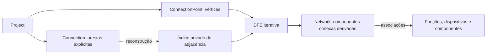

# CAD-CRAFT — ETAPA 2 CONCLUÍDA

Data: 2026-10-27, America/Sao_Paulo.
**Estado: concluída tecnicamente. Implementada e testada automaticamente;
homologação manual pendente.**

Escopo: [anexo integral](../spec/ETAPA_02_CONECTIVIDADE_REDES.md).
Planejamento/registro: [plano](../plans/2026-10-27-etapa-02-conectividade.md).
Decisão: [ADR-0004](../../adr/0004-conectividade-logica-e-redes-derivadas.md).
Etapa 3 não iniciada e aguardando autorização.

## Objetivo e arquitetura

Implementada conectividade elétrica lógica no Core existente, preservando o domínio
da Etapa 1, workspace e independência da GUI. Não há dependências novas: std, Serde
e uuid permanecem; serde_json continua exclusivo de testes. Cargo.lock e manifests
não foram alterados. cad-gui permanece o diagnóstico de console da Etapa 1.

Connection possui ConnectionId UUID v7, ProjectId e extremos ConnectionPointId.
Os extremos são canônicos: menor ID em source e maior em target. Não existe direção
de corrente nesses nomes. A–B e B–A são a mesma aresta para duplicação. IDs seguem
a macro existente, com validação de versão/variante, Eq/Ord/Hash, conversão e Serde.

O agregado guarda as conexões em BTreeMap, com índice privado simétrico em graph.rs.
O índice é reconstruível, não serializado e conferido por Project::validate. Somente
pontos e conexões são fonte persistente. Nenhum módulo vazio, biblioteca de grafos
externa, cache persistente de redes ou NetworkId foi acrescentado.

**Conexão lógica não equivale a condutor físico nem representação gráfica.**
Não implementados: WireRoute, WireJunction, seção/cor/comprimento de condutor,
roteamento visual, editor, simulação de estados, ERC completo ou exportação DXF.

## Integração e operações públicas

As assinaturas seguem a nomenclatura real da Etapa 1: insert_connection/connection,
equivalentes às operações add/get sugeridas conceitualmente pelo anexo.

| API | Resultado / contrato |
|---|---|
| Connection::new(project, a, b) | Result<Connection>; rejeita autoaresta e ordena extremos |
| Connection::id / project_id / endpoints | Identidade e extremos imutáveis |
| Project::insert_connection(connection) | Result<ConnectionId>; valida antes de mutar |
| Project::connection(id) | Option<&Connection> |
| Project::connections() | Iterador imutável em ordem de ConnectionId |
| Project::remove_connection(id) | Result<Connection>; retira apenas aresta e incidências |
| Project::are_connected(a, b) | Result<bool>; conectividade transitiva explícita |
| Project::network_for_point(id) | Result<Network>; componente do ponto |
| Project::networks() | Vec<Network>; todas as componentes, incluindo isolados |
| Project::directly_connected_points(id) | Result<Vec<ConnectionPointId>>; vizinhos ordenados |
| Project::incident_connections(id) | Result<Vec<ConnectionId>>; arestas ordenadas |
| Project::are_devices_connected(a, b) | Result<bool>; alguma rede compartilhada por pontos |
| Network::points / connections / functions / devices / components | Slices imutáveis ordenadas e únicas |
| Network::has_cycle() | Ciclo topológico na componente, sem julgamento elétrico |

Network é fotografia possuída da consulta; reconsultar após alterações no Project.
Todos os seus membros são ordenados por ID; redes pelo menor ponto. Ponto existente
está conectado a si, mesmo isolado; ponto inexistente sempre retorna erro, inclusive
em A–A. Dispositivo sem pontos não compartilha rede, nem consigo mesmo.

## Algoritmos e redes

Vértices são pontos funcionais e arestas são conexões explícitas. DFS iterativa marca
os pontos na descoberta, evitando entradas repetidas na pilha e recursão profunda.
Pontos sem incidências formam componentes unitárias. Pares, cadeias, ramificações,
redes independentes e ciclos são suportados. Remover uma ponte divide a rede;
remover uma aresta de ciclo pode manter todos os pontos conectados.

Aresta entre pontos já ligados indiretamente é válida. Uma componente simples conexa
tem ciclo quando |E| >= |V|. Os algoritmos não simulam bobinas/contatos ou estados.

Funções associadas vêm dos pontos; dispositivos vêm das funções. Componentes vêm
de associação explícita com função ou de propriedade de terminal mapeado pelo ponto.
Compartilhar dispositivo, função ou mesmo terminal físico não cria arestas.
Um contator pode aparecer em várias redes independentes; não se unem automaticamente
seus terminais de bobina, contatos auxiliares ou contatos principais.

## Integridade e decisões de compatibilidade

- Connection valida localmente extremos distintos no construtor e na desserialização.
  Project valida pertencimento, existência dos dois pontos, ID e par únicos.
- Pontos de outro projeto não registrados localmente são MissingEntity; um Project
  isolado não descobre o proprietário de um UUID externo. Conexão com ProjectId
  incompatível retorna ForeignProject. Pontos estrangeiros também não podem ser
  inseridos/importados como entidades válidas no agregado.
- DuplicateConnectionId, DuplicateConnection, SelfConnection e MissingConnection
  são erros estruturados, além dos erros referenciais existentes.
- Todas as verificações recuperáveis antecedem a primeira escrita de inserção.
  Remoção inexistente não altera nada. Remoção válida preserva pontos, terminais,
  dispositivos, funções, componentes e outras conexões. Sem exclusão em cascata.
- Nenhuma propriedade adicional de Connection foi justificada pelo escopo.
  EntityRef mantém seus alvos anteriores; não aponta para conexões removíveis.
  Isso evita introduzir referências pendentes em propriedades após remoção.
  A extensão futura exigirá definir os atributos e sua política referencial.
- Não houve divergência impeditiva com a Etapa 1. Foram ampliados contratos antes
  futuros, preservando APIs existentes e todos os testes anteriores.

## Serialização e reconstrução

O snapshot do Project acrescenta uma lista connections. IDs e ProjectId são
preservados, extremos invertidos são normalizados sem trocar identidade, IDs
repetidos e pares duplicados são rejeitados. Referências são resolvidas após coletar
as entidades. O índice é reconstruído e comparado na validação completa do agregado.
Campos desconhecidos, dados malformados, autoarestas e referências inválidas falham.

Snapshots da Etapa 1 sem connections são aceitos como lista vazia. Null não é
lista vazia e é rejeitado. Ordem de entrada não altera a serialização canônica.
Redes não são serializadas e são recalculadas após reconstrução. Round-trip inclui
consulta e remoção/reinserção para verificar que o índice foi reconstruído.
Não há formato definitivo .cadcraft, ZIP, armazenamento físico, backups versionados
ou migrações de arquivos nesta entrega.

## Testes e validações observadas

Baseline: cargo test --workspace --locked aprovou os 26 Rust da Etapa 1 antes
das alterações. Ciclos de desenvolvimento observaram falha por APIs ausentes
antes da implementação de conexões (12 testes) e redes (13 testes), seguida de
aprovação das respectivas suítes. Logs em .local/etapa-02, ignorados pelo Git.

`pwsh -NoProfile -File scripts/validate.ps1` terminou com **exit 0**:

| Validação obrigatória | Resultado |
|---|---|
| cargo fmt --check | Aprovado |
| cargo check --workspace --all-targets --locked | Aprovado |
| cargo test --workspace --locked | 55 Rust aprovados, 0 falhas/ignorados |
| cargo clippy --workspace --all-targets --locked -- -D warnings | Aprovado, sem warnings |
| pwsh -NoProfile -File scripts/tests/check-repository.Tests.ps1 | 15 aprovados, 0 falhas |
| git diff --check | Aprovado |
| git diff --cached --check | Aprovado; sem staging |

| Suíte | Quantidade |
|---|---:|
| value_types (preservada) | 8 |
| project_model (preservada) | 7 |
| serialization (preservada) | 10 |
| connections | 6 |
| connectivity | 13 |
| connectivity_serialization | 6 |
| connectivity_scale | 3 |
| doctests compile_fail (1 anterior + 1 novo) | 2 |
| **Total Rust** | **55** |
| **PowerShell** | **15** |
| **Total geral** | **70** |

Não há testes ignorados. Os binários lib/main com zero testes não foram contados.
Os três testes de escala foram executados também em release; não são somados de
novo. Todos os 26 Rust e 15 PowerShell anteriores foram preservados sem alteração.

Cobertura: cenários A–J do anexo, UUID v7/tipagem, erros sem mutação, ordem
determinística, vizinhança/incidência, múltiplas funções e dispositivos, componentes
associados, grafo vazio, isolados, ciclos, remoção de ponte/ciclo, reconstrução e
dados adulterados. Oráculo independente de fecho transitivo compara conectividade
em todos os 64 grafos simples de quatro vértices e em remoções sucessivas.

Verificações adicionais: diagnóstico offline exit 0 sem achados nas regras
auditadas; cargo doc -p cad-craft --no-deps --locked e cargo run -p cad-gui --locked
aprovados. Smoke confirma que o consumidor existente segue funcionando.
Conferência final de whitespace inclui arquivos novos, não cobertos pelo diff comum.

## Desempenho observado

Comando: `cargo test -p cad-craft --test connectivity_scale --release --locked -- --nocapture --test-threads=1`.
Exit 0, três testes aprovados. Rust 1.99.1, Windows, CPU reportada Intel Core
i9-11950H @ 2,60 GHz, quatro processadores lógicos expostos ao ambiente.

Medições com std::time::Instant; **mediana de três amostras por tamanho/topologia**.
Tempos em milissegundos, excluindo compilação. Construção inclui geração de IDs e
entidades; importação inclui desserialização, reconstrução e validação do Project,
mas não a serialização nem a consulta posterior usada como asserção.

| Cadeia: pontos | Construção | Redes | Remover ponte | Redes após divisão | Importação |
|---|---:|---:|---:|---:|---:|
| 100 | 0,233 | 0,055 | 0,001 | 0,043 | 0,320 |
| 1.000 | 1,957 | 0,970 | 0,003 | 0,584 | 3,641 |
| 10.000 | 26,683 | 10,352 | 0,005 | 8,034 | 42,578 |

| Topologia | Pontos | Construção | Redes | Vizinhos + incidências do centro |
|---|---:|---:|---:|---:|
| Estrela | 100 | 0,223 | 0,089 | 0,005 |
| Estrela | 1.000 | 3,115 | 0,737 | 0,021 |
| Estrela | 10.000 | 28,070 | 10,469 | 0,548 |
| Isolados | 100 | 0,310 | 0,228 | — |
| Isolados | 1.000 | 3,856 | 2,055 | — |
| Isolados | 10.000 | 37,748 | 24,532 | — |

Isolados possuem uma função e um componente explícito por ponto, exercitando o
enriquecimento de muitas redes. Estrelas também removem metade das arestas; cadeias
dividem ao meio e reconstroem o snapshot. Nenhum limite de tempo é usado como teste.
São observações locais com poucas amostras, sujeitas a carga do host e precisão
do relógio; não constituem metas, comparação entre máquinas ou garantia industrial.

Complexidade da conectividade: inserção/remoção têm buscas O(log E + log V + log grau).
Vizinhança direta custa O(log V + grau); incidências também ordenam os IDs retornados.
DFS é iterativa e as árvores ordenadas acrescentam fatores logarítmicos à travessia.
Para N entidades/arestas no agregado, C componentes e R associações emitidas,
derivar todas as redes tem limite superior O((V + E + C + R) log(N + 2)) e espaço
proporcional ao grafo/índices/resultados. Não é anunciado O(V+E) puro.
Componentes são indexados uma vez por consulta, evitando C varreduras por rede.
network_for_point percorre sua componente e constrói o índice de C componentes;
are_devices_connected pode percorrer o grafo todo, sem enriquecer componentes.
Se funções/componentes aparecem em muitas redes, R cresce com a saída necessária.

## Revisão técnica

Revisão independente por agente interno, somente por inspeção, incluiu código novo
não rastreado, integração com Project/Serde, testes, plano, invariantes, complexidade,
determinismo e separação Core/GUI. **Nenhum achado Critical, Important ou Minor
acionável; nenhum comportamento considerado e deixado sem julgamento.**
O revisor não executou testes nem alterou arquivos/Git. A evidência de execução é
do agente principal. A documentação final foi conferida pelo principal, sem uma
segunda auditoria documental independente. Revisão técnica não é homologação manual.

Deliberações do agente: sem propriedades/EntityRef para Connection por ausência
de requisito; execução/registro no checkout e plano autorizados, sem scripts de
worktree/commit das skills, conforme política expressa. A primeira decisão exige
extensão futura se surgirem referências/propriedades de conexões; a segunda deixa
a criação do histórico/proteção remota sob responsabilidade manual do usuário.
Nenhum achado menor foi adiado.

## Memória, limitações e próximas dependências

Atualizados CURRENT_STATE, HANDOFF, ARCHITECTURE, ROADMAP, KNOWN_ISSUES e DECISIONS;
criado ADR-0004. README e índice de especificações refletem a Etapa 2.

Homologação manual pendente até após Etapa 15. Não há exclusão genérica, histórico,
simulação, ERC completo, representação gráfica ou persistência física definitiva.
Network não tem identidade estável; os resultados possuídos ficam antigos após
mutação. Futuras etapas deverão definir requisitos de nomeação/identidade de redes,
atributos/referências de conexão, representação gráfica e condutores físicos.
Não se presume o conteúdo ainda não recebido da Etapa 3.

Limites anteriores mantidos: geometria em f64, designações sem certificação IEC,
importação completa sem limite de recursos específico, ENV-003 sem confirmação de
reinício e backup externo não criado/verificado. Ver KNOWN_ISSUES.

## Git e inventário

Branch **main**. HEAD local observado com git rev-parse HEAD em 2026-10-27:
`dfbbbc17b3d4cec42362b288e2e74f281f193c08`, commit manual da Etapa 1.
Origin preservado: https://github.com/Vandecao/CAD-CRAFT.git.
Remoto main consultado por git ls-remote --exit-code origin refs/heads/main:
`69f8d6c2877ba617f1c41f8c28d333b67f51e9a8`, no mesmo dia.
Tracking local informa um commit à frente, zero atrás. Não houve fetch/sincronização.

Árvore inicialmente limpa; Etapa 2 ainda não commitada. Este relatório e a memória
atualizada não fazem parte do HEAD observado. Nenhuma operação Git modificadora,
worktree, staging, commit, push ou agente externo utilizado.

**Criados (13):**

- crates/cad-craft/src/domain/connection.rs
- crates/cad-craft/src/domain/network.rs
- crates/cad-craft/src/domain/project/connectivity.rs
- crates/cad-craft/src/graph.rs
- crates/cad-craft/tests/common/mod.rs
- crates/cad-craft/tests/connections.rs
- crates/cad-craft/tests/connectivity.rs
- crates/cad-craft/tests/connectivity_scale.rs
- crates/cad-craft/tests/connectivity_serialization.rs
- docs/adr/0004-conectividade-logica-e-redes-derivadas.md
- docs/internal/plans/2026-10-27-etapa-02-conectividade.md
- docs/internal/reports/ETAPA_02_CONECTIVIDADE_REDES.md
- docs/internal/spec/ETAPA_02_CONECTIVIDADE_REDES.md

**Modificados (15):**

- README.md
- crates/cad-craft/src/domain/ids.rs
- crates/cad-craft/src/domain/mod.rs
- crates/cad-craft/src/domain/project.rs
- crates/cad-craft/src/domain/project/integrity.rs
- crates/cad-craft/src/domain/project/snapshot.rs
- crates/cad-craft/src/error.rs
- crates/cad-craft/src/lib.rs
- docs/internal/memory/ARCHITECTURE.md
- docs/internal/memory/CURRENT_STATE.md
- docs/internal/memory/DECISIONS.md
- docs/internal/memory/HANDOFF.md
- docs/internal/memory/KNOWN_ISSUES.md
- docs/internal/memory/ROADMAP.md
- docs/internal/spec/README.md

**Excluídos:** nenhum. Logs/builds/rustdoc permanecem ignorados, não são entregáveis.
AGENTS, scripts, manifests, lockfile e suítes anteriores preservados.

Próxima ação: revisão, commit e push manuais da Etapa 2, incluindo o commit da
Etapa 1 ainda não enviado. Recomenda-se backup externo independente, não criado.
GitHub protege somente o conteúdo efetivamente enviado. Entrega pronta para revisão.

**ETAPA 2 IMPLEMENTADA — AGUARDANDO REVISÃO, COMMIT E PUSH MANUAIS DO USUÁRIO.**
