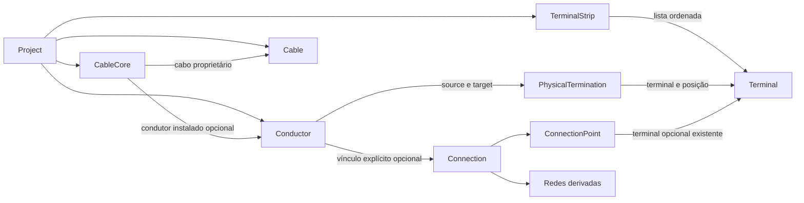

# CAD-CRAFT — ETAPA 3 CONCLUÍDA

Data: 2026-10-27, America/Sao_Paulo.
**Estado: concluída tecnicamente. Etapa 3 — Implementada e testada automaticamente;
homologação manual pendente.**

Escopo: [anexo integral](../spec/ETAPA_03_CONDUTORES_CABOS_BORNES.md).
Plano: [execução e decisões](../plans/2026-10-27-etapa-03-condutores.md).
Decisão: [ADR-0005](../../adr/0005-condutores-cabos-e-terminacoes.md).
Etapa 4 não iniciada, aguardando autorização.

## Objetivo e arquitetura implementada

Implementado o modelo físico de fiação industrial no Core `cad-craft`, mantendo
componentes, dispositivos, terminais físicos e pontos funcionais separados.
Condutores, cabos/veias e réguas documentam elementos reais sem criar conexões
lógicas ou representações gráficas automaticamente. Nenhuma biblioteca nova;
manifests, Cargo.lock e cad-gui permanecem inalterados. std, Serde e uuid são as
dependências do Core; serde_json permanece exclusivo de testes.

Project controla registros BTreeMap, operações tipadas e consultas imutáveis.
PhysicalIndex privado é derivado, reconstruível e não serializado. Não há cópias
persistentes de relações inversas nem clonagem completa do agregado em operações.
O novo código se organiza em entidades, valores, índices e módulos do Project,
adaptando a estrutura conceitual sugerida à organização já existente.

## Condutores e valores físicos

Conductor tem ConductorId UUID v7, ProjectId, designação, dois extremos físicos,
seção nominal, marcação, comprimento/material opcionais, função e propriedades.
Os quatro novos IDs reutilizam a macro anterior, validam versão/variante,
preservam identidade em Serde e têm Eq/Ord/Hash. Total atual: treze categorias.

| Valor | Contrato |
|---|---|
| CrossSectionMm2 | f64 finito, estritamente positivo, unidade mm² |
| LengthMm | f64 finito, não negativo; from_meters converte e valida overflow |
| ConductorMarking | Ao menos cor ou DesignationPart alfanumérica válida |
| ConductorColor | Enum controlado; não determina função elétrica |
| ConductorMaterial | Copper ou Aluminium, opcional no condutor |
| ConductorFunction | Unspecified, Power, Control, Signal, Neutral, ProtectiveEarth |

Comprimento não é calculado do esquema. Designações seguem a política existente
de letras/números, ponto e sublinhado, sem alegação de conformidade IEC. Mesmo ponto
físico nas duas pontas é inválido. Condutores diferentes no mesmo par não direcionado
exigem designações diferentes; IDs são sempre distintos. Em pares diferentes,
designações podem se repetir. Não há dimensionamento, queda de tensão ou ampacidade.

## Terminações e réguas

Terminal da Etapa 1 foi reutilizado; pertence a Device ou Component. Acrescentou-se
um conjunto de posições explicitamente identificadas. PhysicalTermination referencia
TerminalId + posição. Isso permite múltiplas posições por terminal sem usar um
ConnectionPoint funcional como extremo físico e sem criar outro modelo de terminal.

Dois extremos em posições diferentes do mesmo terminal são válidos, mas não se
presume continuidade interna. Não há capacidade de ocupação por posição, renomeação
ou remoção de posições nesta etapa. Terminal antigo carrega posições vazias;
o cliente deve cadastrá-las explicitamente antes de inserir um condutor.

TerminalStrip tem ID, projeto, designação, localização opcional, propriedades
técnicas e lista ordenada de TerminalId. attach_terminal acrescenta ao final.
Um terminal só integra uma régua; associação preserva designação e proprietário.
Bornes multinível, PE, seccionáveis, fusíveis, pontes e acessórios especializados
continuam futuros; agrupamento não implica continuidade entre terminais.

## Cabos e veias

Cable tem ID/projeto/designação, fabricante/catálogo opcionais, CableKind,
quantidade nominal positiva e propriedades. CableCore tem ID/projeto, cabo
proprietário, identificação única nesse cabo, marcação, seção opcional,
ConductorId opcional e propriedades. Cadastro parcial de veias é permitido até
a capacidade nominal; quantidade efetiva é derivada por cores_for_cable.

Veias livres são representáveis. Veia instalada exige seção igual quando declarada
e cores compatíveis quando ambas declaradas. Código da veia e identificação do fio
têm escopos diferentes e não precisam coincidir. Um condutor só ocupa uma veia,
inclusive entre cabos diferentes. Fios individuais não precisam pertencer a cabo.

A única fonte persistente é CableCore.conductor_id. Não se duplica CableId em
Conductor: core_for_conductor/cable_for_conductor derivam referências imutáveis.
Nenhuma continuidade entre veias é presumida.

## Associação lógica/física e integridade

ConductorConnection opcional guarda ConnectionId e source_point. O segundo ponto
vem da Connection. O vínculo valida que ambos os pontos funcionais mapeiem os
terminais correspondentes às extremidades físicas. Source/target são orientação
documental; não indicam sentido de corrente. A conexão pode estar em ordem canônica
oposta à do condutor. Vários condutores distintos podem documentar uma ligação;
cada condutor documenta no máximo uma conexão direta.

Conexão sem condutor, condutor sem conexão e veia livre são estados válidos de
engenharia. Ausência de associação não é corrupção estrutural. Assign/unassign
não alteram o índice lógico nem as redes. remove_connection agora retorna
ConnectionInUse enquanto houver condutores associados; é necessário desvincular
explicitamente. Nenhuma remoção em cascata foi acrescentada.

As inserções verificam IDs, projeto, alvos, posições, duplicações, capacidade,
compatibilidade e propriedades antes de escrever. Entidades desserializadas isoladas
são aceitas apenas depois da mesma validação relacional na inserção. Erros previstos
retornam DomainError, sem panic. Operações inválidas preservam o agregado e índices.
Assign exige vínculo livre; unassign retorna relação anterior ou None. Liberar e
reassociar são duas operações, sem promessa de transação conjunta/Undo/Redo.

Novas entidades físicas integram EntityRef e set_properties; não são removíveis.
Connection continua fora de EntityRef. CrossSection em TechnicalProperties de
condutor/veia é rejeitada para manter fonte única no campo nominal tipado.
Referências em propriedades são verificadas, inclusive ciclos após coleta de snapshot.

## APIs públicas principais

Tipos públicos são exportados em `cad_craft::domain`. Nomes seguem o Core existente.

| API | Retorno / comportamento |
|---|---|
| Terminal::with_positions / Project::add_terminal_position | Cadastro explícito; rejeita posição duplicada |
| PhysicalTermination::new(terminal, position) | Referência composta; existência validada no Project |
| Conductor::new(project, designation, source, target, section, marking) | Result; rejeita extremos idênticos |
| Cable::new(project, designation, kind, nominal_core_count) | Result; capacidade positiva |
| CableCore::new(project, cable, identification, marking) | Veia destacada inicialmente livre |
| TerminalStrip::new(project, designation) | Régua destacada inicialmente vazia |
| insert_conductor / insert_cable / insert_cable_core / insert_terminal_strip | Result com ID; inserção atômica |
| conductor / cable / cable_core / terminal_strip | Option com referência imutável |
| conductors / cables / cable_cores / terminal_strips | Iteradores por ID crescente |
| attach_terminal(strip, terminal) | Acrescenta ao final; pertencimento exclusivo à régua |
| assign_core_conductor(core, conductor) | Exige ambos livres/compatíveis |
| unassign_core_conductor(core) | Result<Option<ConductorId>>; não remove entidades |
| assign_conductor_connection(conductor, link) | Valida orientação e referência lógica explícita |
| unassign_conductor_connection(conductor) | Result<Option<ConductorConnection>> |
| cores_for_cable / core_for_conductor / cable_for_conductor / strip_for_terminal | Consultas inversas derivadas; referências, sem copiar entidades |
| functional_points_for_conductor | Result<Option<(ConnectionPointId, ConnectionPointId)>> na ordem física |
| physical_for_connection / physical_for_device | Result<PhysicalElements>, IDs únicos ordenados |
| Project::validate | Confere referências, compatibilidade e equivalência dos índices |

PhysicalElements é uma fotografia, devendo ser reconsultada após mutação. Por
conexão, contém condutores associados, terminais extremos, veias/cabos e réguas.
Por dispositivo, considera terminais diretos e terminais de componentes
explicitamente associados, condutores incidentes, suas veias/cabos e réguas desses
terminais. Não inclui terminal remoto só por existir um fio até ele. Queries de
dispositivo/conexão inexistente retornam erro; iterador de veias de cabo ausente
é vazio, conforme padrão das consultas inversas anteriores.

## Serialização e reconstrução

Quatro listas físicas novas têm default vazio no ProjectData. Terminal.positions
tem default vazio. Leitura dos snapshots estruturais das Etapas 1/2 é preservada.
IDs e relações são preservados. A coleta detecta IDs duplicados; posições repetidas,
associações conflitantes, campos desconhecidos, valores malformados e referências
ausentes/incompatíveis são rejeitados. Null não substitui listas vazias.

Os registros são ordenados por ID na saída, independentemente da ordem de entrada;
a ordem dentro da régua é preservada como dado. Graph/PhysicalIndex são reconstruídos
e comparados por validate, nunca serializados. Sem formato .cadcraft, ZIP,
migração de schemas, salvamento atômico ou backup versionado.

## Testes e validações executadas

Baseline anterior: **55 Rust aprovados** antes das alterações. Nenhum teste anterior
foi removido ou editado. Testes novos de valores, agregado e Serde foram executados
antes das APIs e apresentaram falhas de compilação esperadas por símbolos ausentes;
depois passaram. Testes de escala e três casos adicionais da revisão foram adicionados
para verificar comportamento já implementado, sem alegação de defeito funcional prévio.

`pwsh -NoProfile -File scripts/validate.ps1`: **exit 0** na execução final, após os
três casos adicionais da revisão.

| Validação | Resultado |
|---|---|
| cargo fmt --check | Aprovado |
| cargo check --workspace --all-targets --locked | Aprovado |
| cargo test --workspace --locked | 88 Rust aprovados; zero falhas/ignorados |
| cargo clippy --workspace --all-targets --locked -- -D warnings | Aprovado; sem warnings |
| scripts/tests/check-repository.Tests.ps1 | 15 aprovados; zero falhas |
| git diff --check e git diff --cached --check | Aprovados; sem staging |

| Suíte | Testes aprovados |
|---|---:|
| value_types | 8 |
| project_model | 7 |
| serialization | 10 |
| connections | 6 |
| connectivity | 13 |
| connectivity_serialization | 6 |
| connectivity_scale | 3 |
| physical_values | 6 |
| physical_wiring | 13 |
| physical_serialization | 8 |
| physical_scale | 2 |
| physical_insertion | 3 |
| doctests compile_fail | 3 |
| **Rust** | **88** |
| **PowerShell** | **15** |
| **Total geral** | **103** |

Zero testes unitários nos alvos lib/main não são contados. Execuções repetidas e
dois testes de escala em release não são contados novamente. Cobertura dos cenários
A–J: fio individual, cabo multipolar, veia livre, régua ordenada, fio sem cabo,
associação lógica, fio sem vínculo lógico, erros atômicos, round-trip e snapshots
anteriores. Também cobre mesma posição/diferentes posições, extremos invertidos,
exclusividade entre cabos, propriedades cíclicas, bloqueio de remoção, determinismo,
incidência via componente e entidades isoladas importadas com vínculos preenchidos.

Adicionais: `cargo doc -p cad-craft --no-deps --locked` e
`cargo run -p cad-gui --locked` aprovados. Consumidor mantém sua mensagem histórica
de Core da Etapa 1, cria/valida Project e continua sem GUI. Diagnóstico offline
aprovado, sem achados nas regras auditadas; não prova ausência de segredos no
histórico nem estado remoto atual. Logs/builds em caminhos ignorados, não entregáveis.

## Desempenho e escalabilidade

Comando: `cargo test -p cad-craft --test physical_scale --release --locked -- --nocapture --test-threads=1`.
Exit 0. Rust 1.99.1, Windows, Intel Core i9-11950H @ 2,60 GHz, quatro processadores
lógicos expostos. std::time::Instant; **mediana de três amostras**, em milissegundos,
sem compilação e sem tempos máximos arbitrários.

Condutores paralelos explicitamente designados, dois terminais e uma conexão lógica;
cabos com quatro veias, todas instaladas. Consulta mede physical_for_connection e
physical_for_device juntas. Construção inclui IDs/entidades/vínculos; validação é
Project::validate. Importação inclui desserialização/reconstrução/validação, excluindo
serialização e asserções posteriores. O teste também libera todos os vínculos antes
de remover a aresta, preservando os condutores e dividindo a rede.

| Condutores | Cabos | Construção | Duas consultas | Validação | Importação |
|---|---:|---:|---:|---:|---:|
| 100 | 25 | 0,400 | 0,162 | 0,182 | 0,736 |
| 1.000 | 250 | 4,754 | 0,737 | 2,268 | 8,669 |
| 10.000 | 2.500 | 45,404 | 7,420 | 27,426 | 91,238 |

Uma régua longa, terminais inseridos em ordem inversa e dois pontos físicos por
terminal; um ponto funcional isolado por terminal. Consulta mede physical_for_device.
Construção inclui o domínio funcional e os bornes; redes permanecem isoladas.

| Bornes | Construção | Consulta | Validação | Importação |
|---|---:|---:|---:|---:|
| 100 | 0,150 | 0,012 | 0,015 | 0,268 |
| 1.000 | 2,623 | 0,099 | 0,254 | 3,466 |
| 10.000 | 23,450 | 1,434 | 3,739 | 34,957 |

Inserções/associações simples usam buscas logarítmicas, além do tamanho das
propriedades/identificações verificadas. Acrescentar borne é append amortizado mais
buscas de árvore; não varre a régua. Inserir uma régua destacada com B bornes valida
todos em O(B log(N+B)). Consultas de cabo usam índice e não varrem outros cabos.
Consulta por conexão é proporcional aos associados, com buscas/ordenação em árvores.
Consulta por dispositivo percorre T terminais e suas incidências: inclui O(T log N)
no pior caso. Validação/importação completa é aproximadamente O((N+R) log N),
considerando registros e referências, mais custo de textos. Índices têm espaço
linear nas relações. Não há alegação de O(1) nem reconstrução completa por inserção.

Medições locais com poucas amostras, sujeitas à carga/relógio do host. Não são metas,
garantia industrial ou medição de projeto real. Não há limite de recursos de importação.

## Revisão independente e avaliação

Agente interno independente fez revisão somente por inspeção, incluindo arquivos
novos não rastreados, invariantes, Serde, índices, complexidade e regressões.
**Sem Critical ou Important.** Um **Minor de cobertura** apontou ausência de testes
de inserção de entidades desserializadas isoladamente com relações já preenchidas.
O principal conferiu os caminhos e acrescentou physical_insertion.rs com três casos:
régua com conflito tardio sem ocupar terminal livre; veia em outro cabo com condutor
já ocupado sem consumir identificação/capacidade; condutor com vínculo lógico
pré-carregado validado e indexado. Todos passaram; suíte completa repetida/aprovada.
Nenhum defeito funcional foi demonstrado e nenhum Minor ficou sem avaliação.

Deliberações sobre comportamentos examinados: custo linear de consulta por dispositivo
é aceitável/documentado nesta etapa; igualdade de seção nominal não é cálculo elétrico;
unicidade de designação de fio é por par físico; entidades isoladas só têm integridade
relacional após registro. Esses contratos foram mantidos e documentados no ADR-0005.
Documentação final foi conferida pelo principal, sem segunda auditoria independente.
O revisor não executou testes nem alterou arquivos/Git. Resultados de execução são
do principal. A revisão não constitui homologação manual.

## Memória, limitações e dependências futuras

Atualizados CURRENT_STATE, HANDOFF, ARCHITECTURE, ROADMAP, KNOWN_ISSUES, DECISIONS
e PROJECT_CONTEXT. Criado ADR-0005, plano, especificação integral e este relatório;
README/índice de especificações atualizados.

Homologação manual adiada até após Etapa 15. Sem CRUD físico genérico, transações
Undo/Redo, renomeação de posições, níveis/ponteamentos especializados, capacidade
de ocupação de borne, cálculos elétricos, simulação, ERC, desenho, renderização,
WireRoute/WireJunction, DXF ou persistência definitiva. Sem conformidade normativa
declarada. Os enums físicos básicos poderão ser ampliados somente com requisitos.
Futuras alterações devem preservar vínculos e bloqueio de remoção, estender testes
e definir migração quando houver formato físico. Não se presume escopo da Etapa 4.

ENV-003 permanece sem confirmação de reinício; DNS impediu consulta remota atual.
Backup externo não foi criado nem verificado. Detalhes em KNOWN_ISSUES.

## Git e inventário da entrega

Branch **main**. HEAD observado por `git rev-parse HEAD` em 2026-10-27:
`98445717f16b9f464aa45664422b6eec12c35781`, commit manual da Etapa 2.
Origin preservado: `https://github.com/Vandecao/CAD-CRAFT.git`.
Tracking local indica 0 à frente/0 atrás. Usuário confirmou envio das Etapas 1/2;
`git ls-remote --exit-code origin refs/heads/main` falhou: Could not resolve host.
Não há SHA remoto atual confirmado nesta sessão; não foi feito fetch.

Árvore inicialmente limpa. Todas as alterações abaixo estão não commitadas; este
relatório/memória não fazem parte do HEAD observado. Nenhuma operação Git
modificadora, staging, worktree, commit, push ou agente externo foi utilizado.

**Criados (20):**

- crates/cad-craft/src/domain/cable.rs
- crates/cad-craft/src/domain/cable_core.rs
- crates/cad-craft/src/domain/conductor.rs
- crates/cad-craft/src/domain/physical_elements.rs
- crates/cad-craft/src/domain/physical_values.rs
- crates/cad-craft/src/domain/project/physical_integrity.rs
- crates/cad-craft/src/domain/project/physical_queries.rs
- crates/cad-craft/src/domain/project/physical_wiring.rs
- crates/cad-craft/src/domain/terminal_strip.rs
- crates/cad-craft/src/physical_index.rs
- crates/cad-craft/tests/physical_common/mod.rs
- crates/cad-craft/tests/physical_insertion.rs
- crates/cad-craft/tests/physical_scale.rs
- crates/cad-craft/tests/physical_serialization.rs
- crates/cad-craft/tests/physical_values.rs
- crates/cad-craft/tests/physical_wiring.rs
- docs/adr/0005-condutores-cabos-e-terminacoes.md
- docs/internal/plans/2026-10-27-etapa-03-condutores.md
- docs/internal/reports/ETAPA_03_CONDUTORES_CABOS_BORNES.md
- docs/internal/spec/ETAPA_03_CONDUTORES_CABOS_BORNES.md

**Modificados (18):**

- README.md
- crates/cad-craft/src/domain/ids.rs
- crates/cad-craft/src/domain/mod.rs
- crates/cad-craft/src/domain/project.rs
- crates/cad-craft/src/domain/project/connectivity.rs
- crates/cad-craft/src/domain/project/integrity.rs
- crates/cad-craft/src/domain/project/snapshot.rs
- crates/cad-craft/src/domain/terminal.rs
- crates/cad-craft/src/error.rs
- crates/cad-craft/src/lib.rs
- docs/internal/memory/ARCHITECTURE.md
- docs/internal/memory/CURRENT_STATE.md
- docs/internal/memory/DECISIONS.md
- docs/internal/memory/HANDOFF.md
- docs/internal/memory/KNOWN_ISSUES.md
- docs/internal/memory/PROJECT_CONTEXT.md
- docs/internal/memory/ROADMAP.md
- docs/internal/spec/README.md

**Excluídos: nenhum.** Manifests, lockfile, scripts, AGENTS e suítes anteriores
preservados. Logs/builds/rustdoc ignorados não integram o inventário da entrega.

Próxima ação: revisão e **commit manual da Etapa 3**. Push manual previsto após
Etapa 4, ainda não autorizada. GitHub protege somente conteúdo efetivamente enviado;
recomenda-se backup externo independente das alterações locais, sem criação automática.

**ETAPA 3 IMPLEMENTADA — AGUARDANDO REVISÃO E COMMIT MANUAL DO USUÁRIO.**
